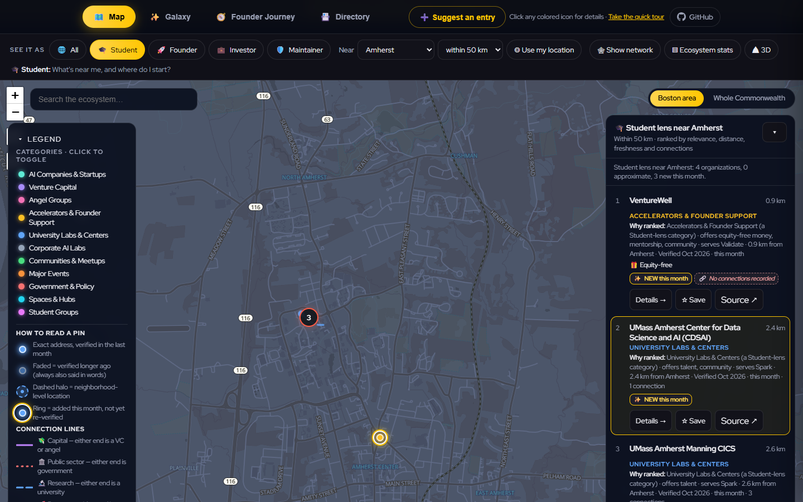
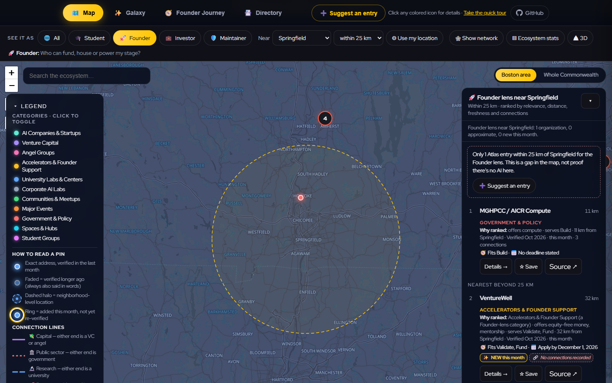
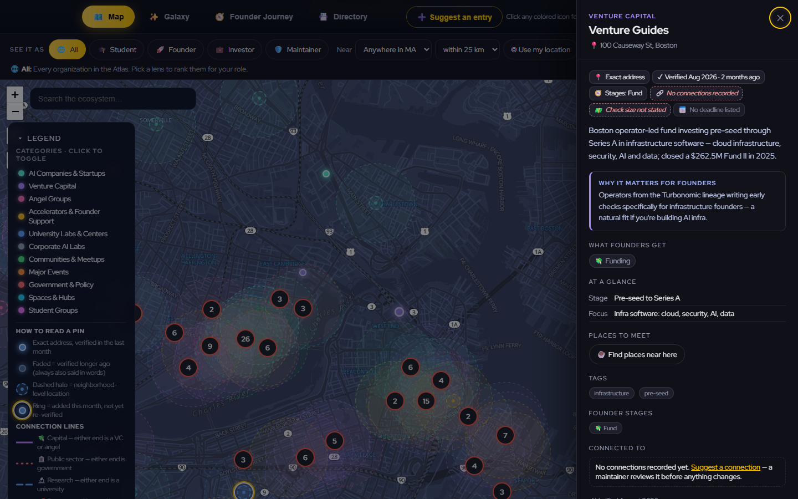
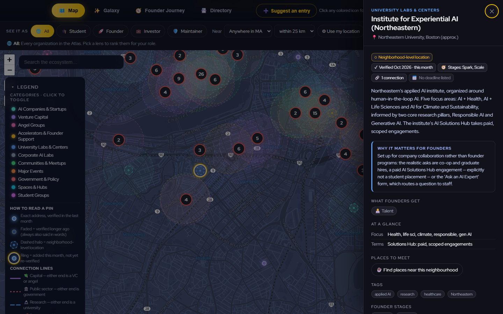
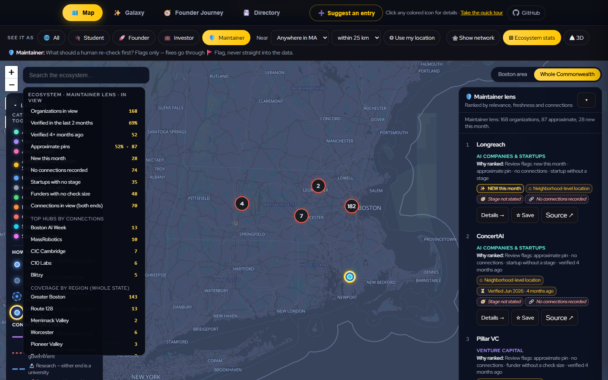
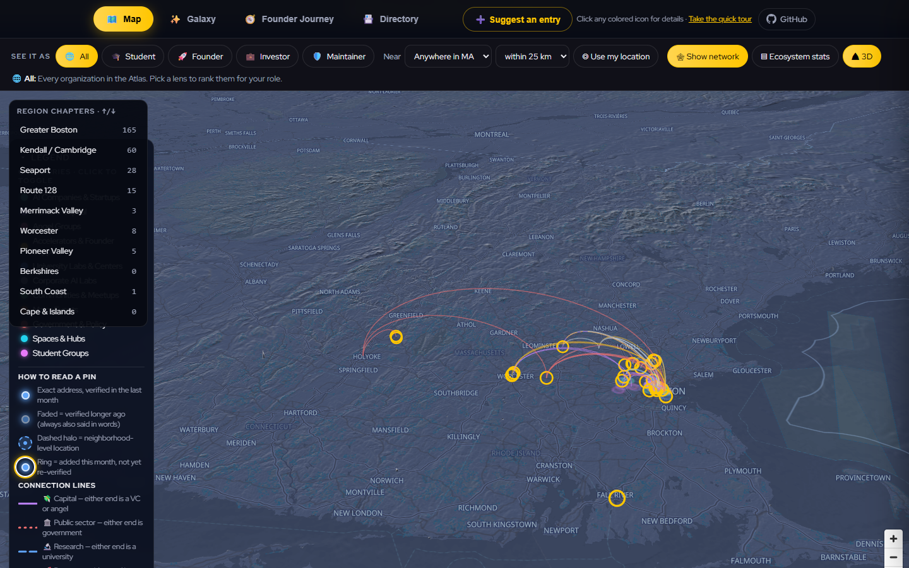
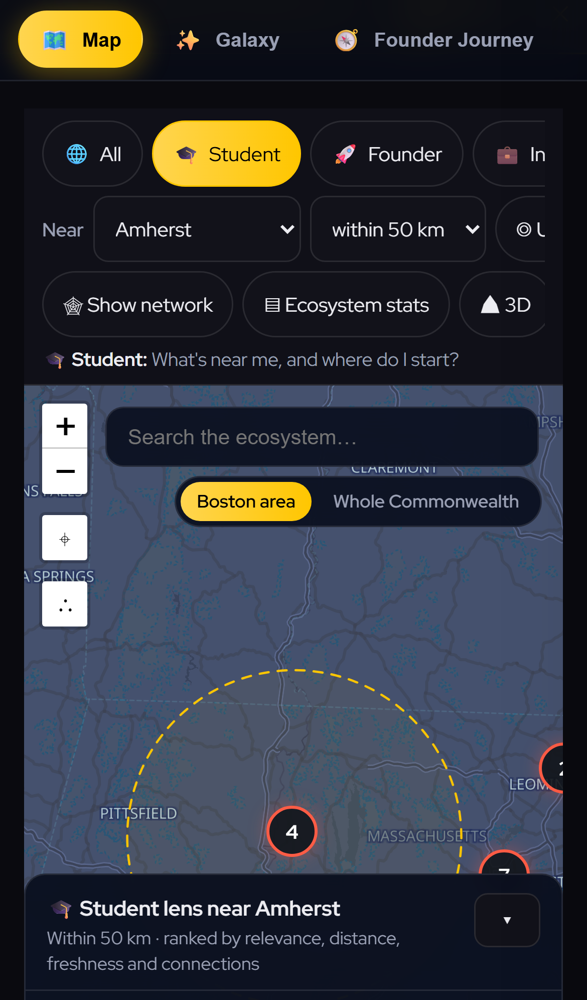

# Atlas Lenses — CommonSpace · Track B "The Passage"

**One map, several lenses.** Each visitor sees the Massachusetts AI ecosystem through their role,
with trust, novelty and connections visible directly on the geographic map: in 2D by default, and in
3D across the whole Commonwealth.

- **Live demo:** https://fredess74.github.io/commonspace-atlas-lenses/
- **Repo:** https://github.com/Fredess74/commonspace-atlas-lenses (a fork of
  [holzerjm/mass-ai-atlas](https://github.com/holzerjm/mass-ai-atlas), branch `feat/atlas-lenses`)
- **Team:** CommonSpace · **Track:** B, "The Passage" (experience and interface)

## The problem

The Atlas already records doubt. It just does not show it.

- An approximate pin was drawn exactly like an exact address, and its popup carried no trust
  information at all.
- A funder with no stated check size, or an entry with no recorded connections, simply omitted the
  section. Missing information was silent.
- Connections existed only in the Galaxy, on mouse hover. They did not appear on the geographic map
  at all, and could not be reached by keyboard or touch.
- A founder, student or investor had to read through every category to reach a shortlist, and a
  search near Springfield returned an empty map with no explanation.

## What we built

Everything extends the existing **Map** view. The four views, the tour, the shortlist, compare,
event ribbons and every deep link work as before, and **All** (the default lens) leaves the map's
original behaviour unchanged.

1. **Lenses.** 🎓 Student · 🚀 Founder · 💼 Investor · 🛡 Maintainer, defined in a single `LENSES`
   config object: emphasised categories (the others are dimmed, never hidden), matching `offers`,
   link types, founder stages, ranking weights and the guiding question shown in the UI.
2. **A ranked shortlist with "why ranked".** Entries are scored by lens relevance, proximity,
   freshness and connectivity, and each result says why it ranked where it did. Each result has
   **Details**, **☆ Save** (the existing shortlist) and **Source ↗** (the entry's own website).
3. **Near.** Pick from the town list, set a radius of 10, 25 or 50 km, or use your location (one
   explicit click, never written to the URL). Distances use a haversine formula we wrote ourselves.
   **Dead ends offer alternatives:** "No Atlas entries within 25 km of Springfield. This is a gap
   in the map, not proof there's no AI here." Below that come the nearest entries beyond the radius,
   with their distances, and **➕ Suggest an entry**.
4. **Trust drawn on the pin, said in words.**
   - Opacity encodes freshness: 1.0 → 0.8 → 0.6 → 0.45.
   - A dashed halo marks an approximate location, with a true-scale ring of about 500 m once you
     zoom in.
   - A gold ring marks entries added this month.
   - Opacity never stands alone: each pin carries "Verified Jun 2026 · 4 months ago" in words.
5. **The six-signal strip** appears in every popup and at the top of every drawer, above the action
   buttons. It shows: location precision · verified month · stage · connection count · check size
   (funders) · deadline. A missing value renders as a dashed *"not stated"* badge and is never
   omitted. Signals that don't apply are shown muted, so a confident entry never looks doubtful.
6. **Connections on the base map.** Selecting an entry draws curved arcs to everything it is
   connected to, on a layer outside the clusters. **🕸 Show network** draws every edge the active
   lens cares about. The drawer's "Connected to" section is grouped by type, and each chip is a
   `?entry=` deep link. Zero links shows "No connections recorded yet" with **Suggest a connection**.
7. **Derived link types, labelled as derived.** The schema stores links as plain ids with no
   relation type, so we derive the type from the two endpoint categories, first match wins:
   capital (VC/angel) → public (gov) → research (university) → program (accelerator) →
   partnership (corporate) → community. Each type has its own colour, dash pattern and icon, and
   every surface that shows one says *"Type inferred from organization categories; the connection
   itself is maintainer-recorded."*
8. **The ecosystem panel ("mini terminal").** It recomputes for the active lens and the current
   viewport: organizations in view, % verified recently, % approximate, new this month, no
   connections, startups without a stage, funders without a check size, edges in view, the top
   hubs, and coverage by region. **Every number is a button that filters the map** to exactly
   those entries.
9. **3D across the Commonwealth (opt-in).** This is a native MapLibre GL map, which the page
   already loads for the basemap, mounted over Leaflet and destroyed on exit.
   - OpenFreeMap buildings render as extrusions from zoom 13.
   - Keyless AWS terrain tiles add hillshade and relief, so the Berkshires and the Pioneer Valley
     read at state zoom.
   - Arcs come from deck.gl `ArcLayer`, loaded only the first time 3D is switched on.
   - Region chapters can be stepped through with ↑/↓, each with its computed count and an honest
     gap message.
   - There is never any auto-rotation or drift, and reduced motion jumps instead of flying.
   - If WebGL, the terrain tiles or deck.gl fail, the page falls back to 2D (or flat, or to plain
     MapLibre lines) and shows a notice. The map is never blank.
10. **Keyboard and phone.** Tab reaches the lens chips → Near → results before any map pin. ↑/↓
    move through results, Enter selects (it pans and draws arcs), and Esc clears. An
    `aria-live` summary, computed every time, reads like "Student lens near Amherst: *n*
    organizations, *n* approximate, *n* new this month." On a phone, the tab bar and lens groups become single
    swipeable rows, results open as a bottom sheet, the legend starts collapsed, and tap targets
    are at least 44 px.

Smaller fixes to the existing UI:

- A tab switch now scrolls to the view instead of leaving it below the hero.
- The legend is collapsible and explains every encoding, not only the colours.
- "Connected to" chips are real links, so a keyboard can reach them.

### Architecture, in three bullets

- **No build step, still one `index.html`.** New code lives in delimited `/* === Atlas Lenses === */`
  sections of vanilla JS and CSS, reusing the page's theme tokens, so dark and light both work.
- **No new runtime dependencies except deck.gl 9.4.0**, which is pinned, MIT-licensed,
  lazy-loaded from jsDelivr only when 3D is first switched on, and optional (there is a fallback).
- **Every number is computed from `DATA`** at runtime. `scripts/lint-copy.js` stays green, and
  `scripts/lens-probe.js` prints the same numbers from the command line. Pure functions
  (`trustOf`, `signalsOf`, `linkTypeOf`, `rankLens`) are exposed on `window` for the tests.

## Declared data sources

| Source | Licence | Used for |
|---|---|---|
| Mass AI Atlas data (`data/*.yml`), The Open Accelerator | CC BY 4.0 | every entry, link, date and fact |
| OpenFreeMap / OpenMapTiles / OpenStreetMap contributors | ODbL / CC BY | basemap, 3D buildings |
| AWS Open Data Terrain Tiles (Mapzen terrarium; USGS and others) | open data, attribution | 3D relief and hillshade |

There is no other data, no API keys, no scraping and no model output presented as a source.
`data/entities.yml` is untouched.

## Morning numbers, now on screen

Snapshot from `node scripts/lens-probe.js 2026-10` (re-run it any time; the page computes the same
numbers live).

| Doubt signal | Count | Before | Now |
|---|---|---|---|
| Approximate pins (`approx: true`) | 87 | drawn identically to exact pins; popup silent | dashed halo + "Neighborhood-level location" in popup and drawer; one click in the ecosystem panel |
| Verified 4+ months ago (all June 2026) | 52 | flagged only after 12 months | faded pin + "Verified Jun 2026 · 4 months ago"; ranks lower; one click |
| Entries with no connection, in or out | 74 | section omitted | "No connections recorded" badge + "Suggest a connection"; one click |
| Startups with no stage | 35 | stage section omitted | "Stage not stated" badge; one click |
| Funders without a stated check size (of 61 funders) | 48 | fact simply absent | "Check size not stated" badge; Founder lens says it on every result; one click |
| Deadlines: rolling / dated | 19 / 2 | shown only while open | rolling · dated · passed · none, always one badge |
| Added this month | 28 | a banner | gold ring on the pin, NEW badge, and the Maintainer lens flags them |
| Undirected connections | 144 | Galaxy only, hover only | arcs on the map on select; the whole network with one toggle; 3D arcs |

Note that the brief's draft counts differed from the data in two places, and the data wins.
`links` holds 170 directed ids, which are 144 unique undirected edges. And the brief's figure of
104 counts only *outgoing* links, while 74 have no connection in either direction.

## What the system refuses to do

- **It never invents organizations or connections.** Every pin and arc comes from
  `data/entities.yml`; "nearest beyond the radius" lists real entries with real distances.
- **It never presents a derived link type as verified.** Every place a type appears says it was
  inferred from categories.
- **It never writes to the dataset.** The Maintainer lens only *flags*; fixes go through the
  existing 🚩 Flag and Suggest issue flows, which a human reviews.
- **It says "gap in the map" or "not stated" instead of guessing.** It does not fill a missing check
  size, stage or deadline, and it does not treat an empty radius as an empty ecosystem.
- **It never stores or shares a visitor's location.** "Use my location" is one explicit click, and
  the coordinates are never written to the URL.

## Demo script (real entries)

1. `?lens=student&near=amherst&r=50`: VentureWell, CDSAI, CICS and CIIR rank with their reasons.
   Select CDSAI to see its arc to CICS. Toggle **3D** and pick the **Pioneer Valley** chapter:
   terrain, and with 🕸 the arcs climb east to Boston.
2. Switch Near to **Springfield**: the honest gap message, the nearest alternatives with distances,
   and ➕ Suggest an entry.
3. **Investor** lens near Boston, `?lens=investor&near=boston&entry=blitzy`: Blitzy's backers
   appear as capital arcs ("who else backed this"), and each funder in the list names its
   co-investors on the same startups.
4. **"Which do you trust less?"** Compare `?entry=venture-guides` with `?entry=eai`.
   - Venture Guides has an exact address and was verified in Aug, but has **no connections** and
     **no check size**.
   - EAI was verified in Oct with 1 connection, but its location is **approximate**.
   - The six-signal strip answers it in three seconds.
5. Judge's pick: paste `?entry=<id>`. The arcs, signals and source link all work. "Click a source":
   **Visit website ↗** in the drawer, or **Source ↗** on every result.
6. **Maintainer** lens: entries ranked by review priority, with the flags as reasons. Open ▤
   Ecosystem stats and click any number to filter.

Every lens state is a link: `?lens=founder&near=worcester&r=25&entry=<id>&mode=3d`, and `?asof=YYYY-MM`
pins "now" for repeatable demos.

## Screenshots

| | |
|---|---|
|  |  |
|  |  |
|  |  |
|  | |

## Checks

```bash
node scripts/validate.js && node scripts/lint-copy.js && npm run test:e2e
node scripts/lens-probe.js 2026-10
```

`tests/lenses.spec.js` covers:

- ranked results with reasons;
- the gap message and nearest alternatives;
- arcs and the "inferred" grouping on `?entry=`;
- the `trustOf` opacity steps;
- the zero-connection message;
- link-type precedence;
- the keyboard-only path;
- the 3D mount and its fallback;
- ecosystem drill-down.

If a browser test fails under parallel workers, re-run it with `--workers=1`, as `HACKATHON.md`
advises.

---

*Built on the Mass AI Atlas by The Open Accelerator, with Red Hat, the Massachusetts AI Hub and IBM:
dataset CC BY 4.0, code MIT. Map data © OpenStreetMap contributors via OpenFreeMap.*
